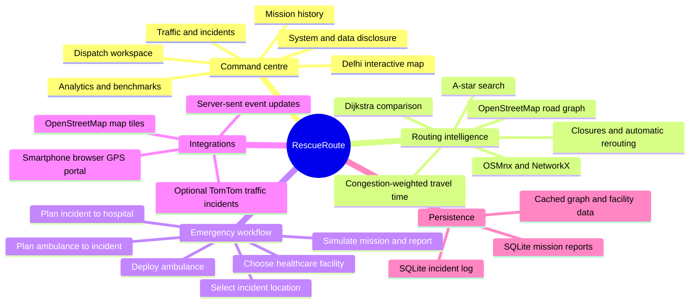
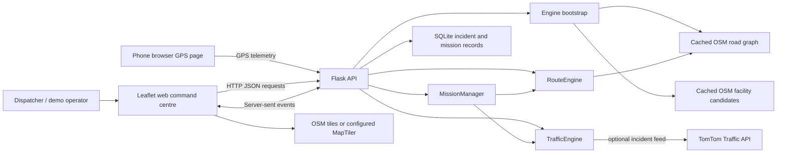

# RescueRoute

### Emergency geospatial intelligence and ambulance-dispatch prototype for Delhi

RescueRoute is a map-based command-centre prototype for exploring how road-network routing, emergency dispatch, traffic disruptions, and ambulance telemetry can work together. An operator can place an incident, deploy a simulated ambulance, select a nearby healthcare facility, and watch a mission travel to the incident and then to the hospital. If a road on the route is disrupted, the system can calculate a replacement route.

> **Prototype, not an emergency service.** RescueRoute does not dispatch real ambulances or provide emergency medical advice. Road geometry and facility locations come from OpenStreetMap; facility records are not independently verified. Unless explicitly connected to a live provider or device, ambulance movement, traffic conditions, incidents, hospital availability, and travel speeds are simulated or estimated.

## Project blueprint



## What the project is for

Emergency response depends on more than finding the shortest line between two points. Dispatchers need to consider the drivable road network, changing road conditions, vehicle location, destination, and the effect a disruption has on a trip already in progress.

RescueRoute brings those ideas into one demonstrable system. Its core purpose is to:

1. Represent Delhi's drivable roads as a routable, directed graph.
2. Plan an ambulance journey from its current location to an emergency and onward to a healthcare facility.
3. Compare A* and Dijkstra on the same travel-time cost model.
4. Model congestion, accidents, and closures, then respond to disruptions with rerouting.
5. Show mission progress and operational history in a single map-based interface.

## What's implemented

| Workspace / capability | What it does |
| --- | --- |
| **Dispatch** | Choose an incident location from the map or presets, add an ambulance, select a facility, choose A* or Dijkstra, and plan or start a mission. |
| **Live mission simulation** | Advances an ambulance along its route, shows mission progress and events, and supports start, pause, resume, and abort actions. |
| **Traffic & incidents** | Add congestion or a road disruption to a segment, inspect active incidents, resolve incidents, and reset simulated conditions. |
| **Dynamic rerouting** | Recalculates a route when a disruption affects an active mission. |
| **Healthcare facilities** | Loads cached OpenStreetMap hospital/clinic candidates, finds nearby facilities, and displays clearly labelled availability data. |
| **A* and Dijkstra comparison** | Measures route-search time and expanded nodes, and reports route-distance and travel-time metrics. |
| **Analytics** | Displays benchmark and mission-performance information in the dashboard. |
| **Mission history and reports** | Records incidents, missions, and mission reports in SQLite. |
| **Driver GPS page** | Provides a browser-based page that can send a device's GPS readings to the telemetry endpoint, subject to browser permission and device/network access. |
| **Live updates** | Uses a server-sent events stream for operational updates. Optional TomTom incident data can be enabled with a key; otherwise the app uses simulated traffic conditions. |
| **System transparency** | Shows which data is real, estimated, simulated, or not integrated. |

### Typical demonstration

1. Open **Dispatch** and set an emergency location on the map or choose a preset.
2. Add an ambulance at its starting point.
3. Choose a hospital or clinic and select A* or Dijkstra.
4. Plan and start the mission. The planned trip has two legs: ambulance → emergency → hospital.
5. In **Traffic & Incidents**, place a closure or congestion on a road used by the mission.
6. Observe the mission reroute and review its status, events, and report.
7. Open **Analytics** to inspect route-search benchmarks, or **History** to review saved reports.

## How it fits together



### Routing model

- The road network is a directed, multi-edge graph loaded from a cached GraphML file or downloaded with OSMnx.
- Coordinates are snapped to nearby graph nodes.
- Edge travel-time weights use estimated road-class speeds, an emergency speed factor, and the current traffic multiplier.
- A closed segment is excluded from route search.
- The routing engine implements **A*** and **Dijkstra** against that same weighted cost model.
- The comparison harness repeats both searches and summarizes compute time, nodes expanded, distance, and travel time.
- Mission simulation follows the ambulance-to-emergency leg, a short on-scene dwell, and the emergency-to-hospital leg.
- Live telemetry can update an ambulance's reported position. This telemetry is not equivalent to a verified dispatch or tracking service.

## Data and operational boundaries

| Data or behavior | Current source / status |
| --- | --- |
| Delhi drivable road geometry and graph topology | Real OpenStreetMap data processed with OSMnx. A graph is cached locally for startup. |
| Hospitals, clinics, and doctors' locations | OpenStreetMap candidates. **Not independently verified.** |
| Base-map tiles | OpenStreetMap by default; MapTiler can be configured. |
| Road-class speeds and travel-time costs | Configured estimates, not measured emergency-vehicle speeds or guaranteed ETAs. |
| Traffic, accidents, and closures | Simulated by default. Optional TomTom incident polling is supported when configured. |
| Ambulance location and motion | Simulated in the command centre unless device telemetry is supplied. |
| Hospital beds, capacity, and operational status | Simulated by default; not a live hospital availability feed. |
| Government traffic feeds, live accident detection, and real emergency dispatch | Not integrated. |

The interface and API expose data-source labels and disclaimers. Treat this project as a software/algorithm demonstration, not an operational source of truth.

## Technology

- **Backend:** Python, Flask
- **Road graph and routing:** OSMnx, NetworkX, custom A*/Dijkstra route engine
- **Geospatial data:** OpenStreetMap, GeoPandas, Shapely
- **Frontend:** HTML, CSS, vanilla JavaScript, Leaflet
- **Live browser updates:** Server-sent events (SSE)
- **Persistence:** SQLite
- **Optional integrations:** TomTom traffic incidents, MapTiler map tiles, browser geolocation

## Repository map

```text
.
├── app.py                  Flask pages, API routes, and engine bootstrap
├── config.py               Map, network, speed, traffic, and integration settings
├── core/
│   ├── db.py               SQLite schema and persistence helpers
│   ├── facilities.py       OpenStreetMap facility loading and availability model
│   ├── mission.py          Mission lifecycle, simulation, rerouting, and reports
│   ├── network.py          Road graph loading, download, annotation, and export
│   ├── routing.py          A*, Dijkstra, route geometry, and benchmarks
│   └── traffic.py          Segment conditions, incidents, and optional live traffic
├── templates/
│   ├── index.html          Main map-based command centre
│   └── driver.html         Browser GPS telemetry page
├── static/
│   ├── css/style.css       Dashboard styling
│   └── js/                 Dashboard behavior and motion effects
├── scripts/                Smoke, API-demo, data-build, and UI test utilities
├── data/
│   ├── cache/              Locally cached road graph, GeoJSON, and facilities
│   └── rescueroute.db      SQLite records (created by the app)
├── requirements.txt        Python dependencies
└── README.md               Project blueprint and setup
```

The graph and other cached data can be large. Keep local caches and credentials out of Git unless you intentionally choose a distribution strategy for them.

## Run locally

### Windows PowerShell

From the project directory:

```powershell
py -m venv .venv
.\.venv\Scripts\Activate.ps1
python -m pip install -r requirements.txt
python app.py
```

Then open **http://127.0.0.1:5000/**. On first startup, graph acquisition may take time if the Delhi road graph is not already cached. The app can reuse the local graph and facility cache on later starts.

To run the headless routing smoke test in another terminal:

```powershell
.\.venv\Scripts\Activate.ps1
python scripts\smoke_test.py
```

The API demo script expects the app to already be running:

```powershell
python scripts\api_demo_test.py
```

## Deploy the complete application

This is a stateful Flask application, not a static site: it loads a Delhi road graph (about 261 MB in the current local cache), writes SQLite data, and keeps mission/traffic state and background work in a long-running process. Vercel's serverless deployment is not a suitable single-host target for the complete application. Use a Docker-capable Python host with a persistent volume instead.

The repository includes a `Dockerfile` and startup script. Deploy the repository from GitHub using that Dockerfile, and attach a persistent volume mounted at `/app/runtime-data`. The first start downloads the road graph to that volume and can take several minutes; later restarts reuse it. Keep one Gunicorn worker so in-memory mission and traffic state is shared. The bundled hospital cache stays in the image and is used when the persistent cache is empty; a successful facility refresh writes its result to the persistent cache.

Set `TOMTOM_API_KEY` as a private environment variable in the hosting provider's dashboard, then redeploy. Set `MAPTILER_API_KEY` there too if you want MapTiler tiles; that key is delivered to the browser as part of the tile URL, so use a MapTiler key restricted to your deployed domain. Never commit either key to GitHub. The local `.env` is ignored by Git and excluded from the Docker image, so deployment environment variables must be configured on the host. Without a TomTom key, live incidents are disabled and the interface reports simulated traffic. Once running, verify `/api/status` reports a ready engine and non-zero facility count; verify `/api/hospitals?lat=28.6139&lng=77.2090&clinics=0` returns hospital records.

## Configuration

`config.py` contains the default Delhi map center, network settings, speed estimates, traffic multipliers, and cache paths. Optional integrations read environment variables from a local `.env` file:

| Variable | Purpose |
| --- | --- |
| `TOMTOM_API_KEY` | Enables optional TomTom traffic-incident polling. Without it, traffic remains simulated. |
| `MAPTILER_API_KEY` | Enables MapTiler map tiles. OpenStreetMap tiles are used when no key is configured. |
| `MAPTILER_STYLE_ID` | Optional MapTiler style identifier; defaults to `streets-v4`. |
| `RESCUEROUTE_DATA_DIR` | Optional writable data directory for a hosted deployment. The Docker image sets this to `/app/runtime-data`; mount a persistent volume there. |

Do not commit `.env` or paste API keys into source code or public issue reports.

## API outline

The Flask API is served by `app.py`. JSON endpoints include:

| Method | Endpoint | Purpose |
| --- | --- | --- |
| `GET` | `/api/status` | Engine, network, facilities, traffic, mission, and database status. |
| `GET` | `/api/network` | Road-network GeoJSON; optional `west`, `south`, `east`, `north` bounds. |
| `GET` | `/api/hospitals` | Facility list or nearby facilities for `lat` and `lng`. |
| `POST`, `GET`, `DELETE` | `/api/ambulances` | Add, list, and remove simulated ambulance units. |
| `POST` | `/api/route` | Calculate a route; can request an A*/Dijkstra comparison. |
| `POST`, `GET` | `/api/incidents` | Create or list road incidents. |
| `POST` | `/api/incidents/<id>/resolve` | Resolve an active incident. |
| `GET` | `/api/incident-log` | Read persisted incident history. |
| `POST` | `/api/traffic`, `/api/traffic/reset` | Set a segment's traffic condition or clear conditions. |
| `POST`, `GET` | `/api/missions` | Create a mission or list active missions. |
| `GET` | `/api/missions/<id>` | Read current mission state. |
| `POST` | `/api/missions/<id>/<action>` | Start, pause, resume, or abort a mission. |
| `GET` | `/api/missions/<id>/report`, `/api/reports` | Read mission reports. |
| `POST` | `/api/telemetry/ambulance` | Receive ambulance GPS telemetry. |
| `GET` | `/api/stream` | Receive server-sent operational updates. |

## Next-level roadmap

These are potential next steps—not claims about current functionality:

1. **Operational data quality:** verify facility identities, locations, and contacts with authoritative sources; integrate a permissioned hospital availability feed.
2. **Real traffic integration:** formalize provider configuration, polling/error monitoring, data freshness indicators, and provider terms/quota handling.
3. **Dispatch-grade reliability:** add authentication, role-based access, audit trails, validation, monitoring, backups, and a production WSGI server.
4. **Location and mission safety:** define consent and retention for GPS data; add stale-device handling, accuracy thresholds, and operator confirmation.
5. **Routing evaluation:** compare estimates against measured trips, document assumptions, and test route behavior across closures, disconnected areas, and concurrent missions.
6. **Deployment and scale:** separate API, background mission processing, and persistent storage as needed; document deployment, migrations, and recovery.
7. **Accessibility and usability:** test keyboard operation, small-screen driver use, map alternatives, and clear degraded/offline states.

## License and attribution

Road and facility data are sourced from OpenStreetMap. Follow the [OpenStreetMap copyright and attribution requirements](https://www.openstreetmap.org/copyright). Check the terms of any optional map-tile or traffic-data provider before deploying or redistributing the project.
